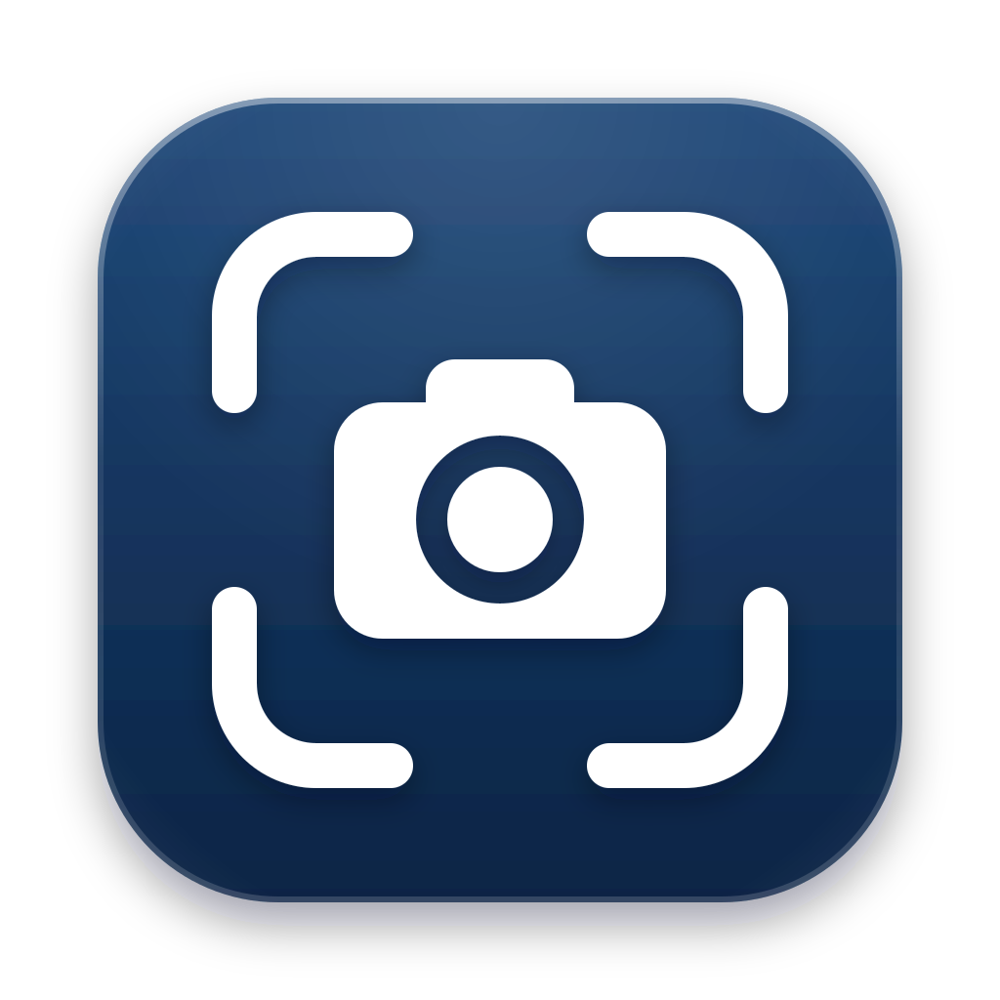
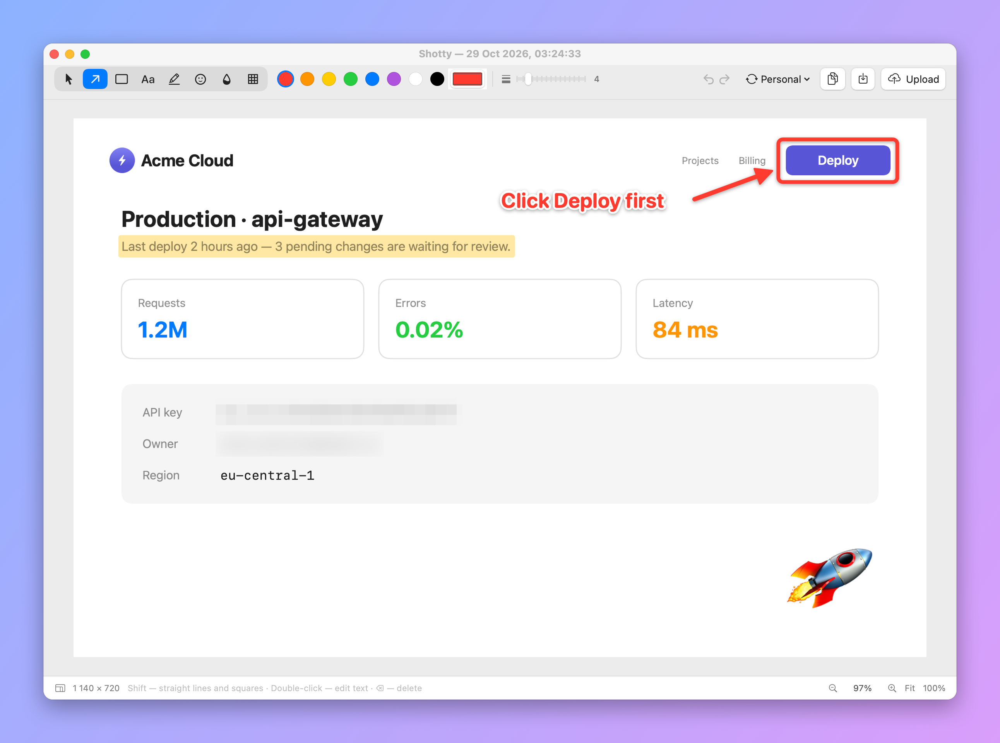
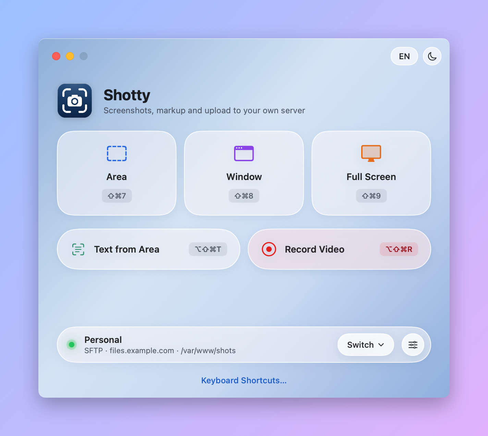
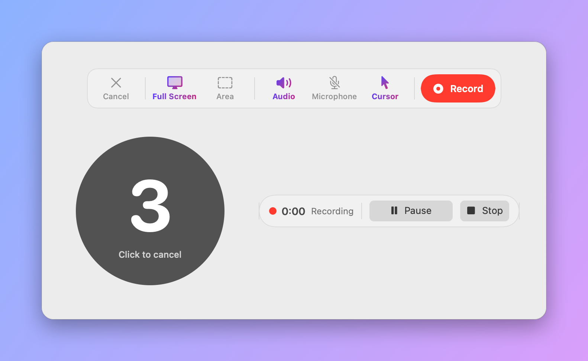
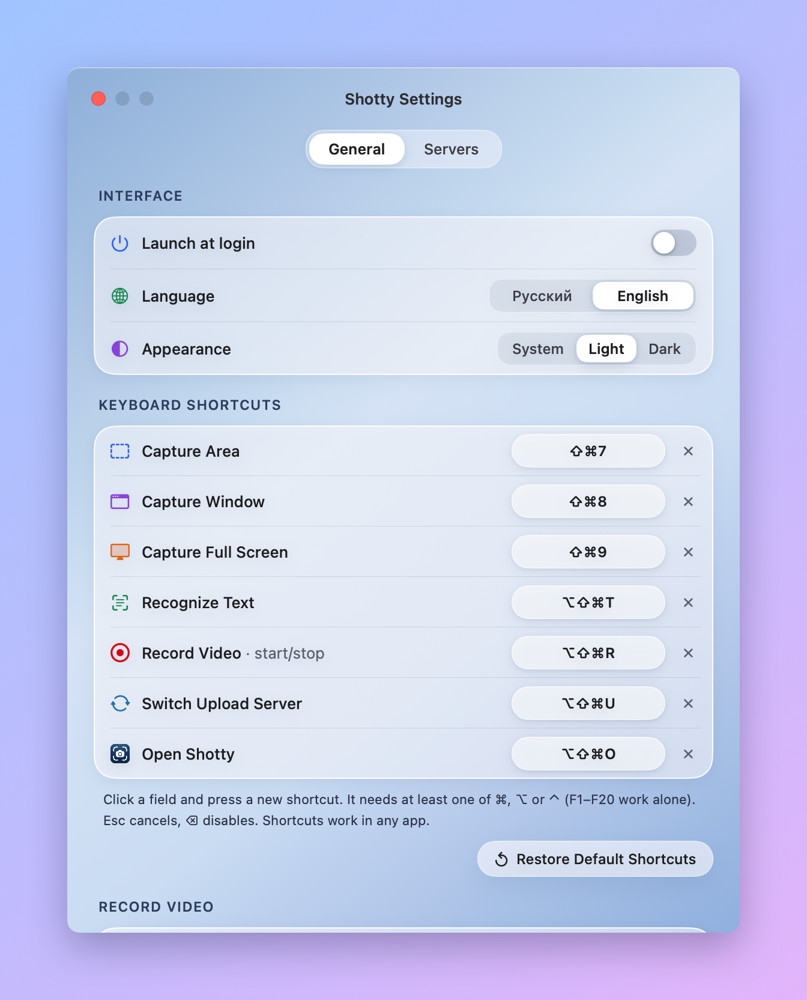
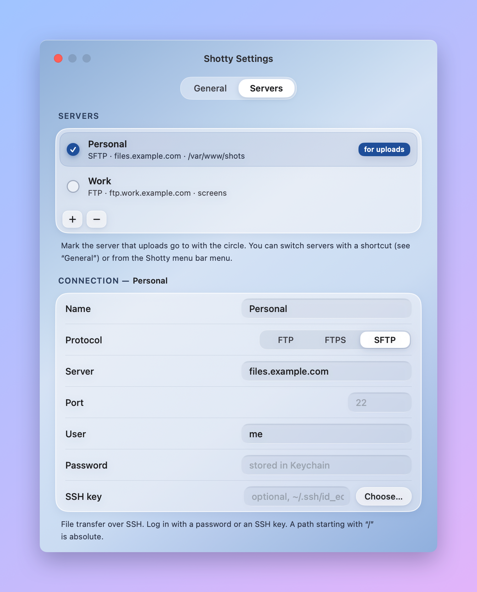

<p align="center">
  
</p>

<h1 align="center">Shotty</h1>

<p align="center">
  A native macOS app for screenshots, annotations and screen recording — with upload to your own server.
</p>

<p align="center">
  <a href="https://github.com/aldr-dev/Shotty/releases"></a>
  
  
</p>

<picture>
  <source media="(prefers-color-scheme: dark)" srcset="docs/screenshots/editor-dark.png">
  
</picture>

## Download

**[Shotty.dmg](https://github.com/aldr-dev/Shotty/releases/download/v1.1.1-beta/Shotty.dmg)** — universal build (Apple Silicon + Intel), macOS 15 or later.

Open the DMG and drag Shotty into Applications. All versions are on the [Releases](https://github.com/aldr-dev/Shotty/releases) page.

## Features

- **Screenshots** — area, window or whole screen, each with its own global hotkey
- **Editor** — arrows, frames, text, highlighter, emoji, blur and pixelate; undo/redo and zoom
- **Text recognition (OCR)** — select an area and the text goes straight to the clipboard
- **Screen recording** — full screen or an area, system audio and microphone, pause, 5‑second countdown before start
- **Upload** — FTP, FTPS and SFTP, several server profiles, passwords stored in Keychain, public link copied after upload
- **Notifications** — upload progress with Cancel, "link copied", "saved" with Show in Finder, errors with Retry
- Russian and English UI, light and dark theme, launch at login

## Screenshots

### Home

<picture>
  <source media="(prefers-color-scheme: dark)" srcset="docs/screenshots/home-dark.png">
  
</picture>

### Screen recording

Pick full screen or an area, toggle system audio, microphone and cursor, then a countdown gives you time to get ready.

<picture>
  <source media="(prefers-color-scheme: dark)" srcset="docs/screenshots/recording-dark.png">
  
</picture>

### Settings

<table>
  <tr>
    <td>
      <picture>
        <source media="(prefers-color-scheme: dark)" srcset="docs/screenshots/settings-general-dark.png">
        
      </picture>
    </td>
    <td>
      <picture>
        <source media="(prefers-color-scheme: dark)" srcset="docs/screenshots/settings-servers-dark.png">
        
      </picture>
    </td>
  </tr>
</table>

## Keyboard shortcuts

| Action | Default |
|---|---|
| Capture area | <kbd>⇧</kbd><kbd>⌘</kbd><kbd>7</kbd> |
| Capture window | <kbd>⇧</kbd><kbd>⌘</kbd><kbd>8</kbd> |
| Capture full screen | <kbd>⇧</kbd><kbd>⌘</kbd><kbd>9</kbd> |
| Recognize text | <kbd>⌥</kbd><kbd>⇧</kbd><kbd>⌘</kbd><kbd>T</kbd> |
| Start / stop recording | <kbd>⌥</kbd><kbd>⇧</kbd><kbd>⌘</kbd><kbd>R</kbd> |
| Switch upload server | <kbd>⌥</kbd><kbd>⇧</kbd><kbd>⌘</kbd><kbd>U</kbd> |
| Open Shotty | <kbd>⌥</kbd><kbd>⇧</kbd><kbd>⌘</kbd><kbd>O</kbd> |

All shortcuts can be changed in Settings → General.

## First launch

Shotty is not notarized by Apple yet, so macOS will warn that the developer cannot be verified. To open it:

- right‑click Shotty in Applications → **Open** → **Open**, or
- run in Terminal:

  ```bash
  xattr -dr com.apple.quarantine /Applications/Shotty.app
  ```

Then allow **Screen & System Audio Recording** for Shotty in System Settings → Privacy & Security, and restart the app.

## Build from source

No Xcode project needed — only the Swift toolchain (Command Line Tools).

```bash
./build.sh
```

The script compiles a universal binary, generates the icon and packs `build/Shotty.app` and `build/Shotty.dmg`.

## Feedback

This is a beta — please report bugs and ideas in [Issues](https://github.com/aldr-dev/Shotty/issues).
